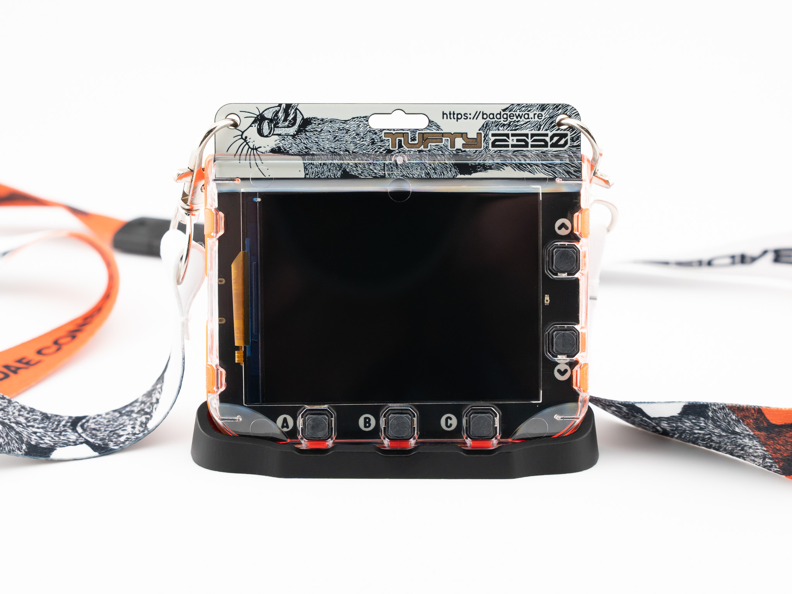
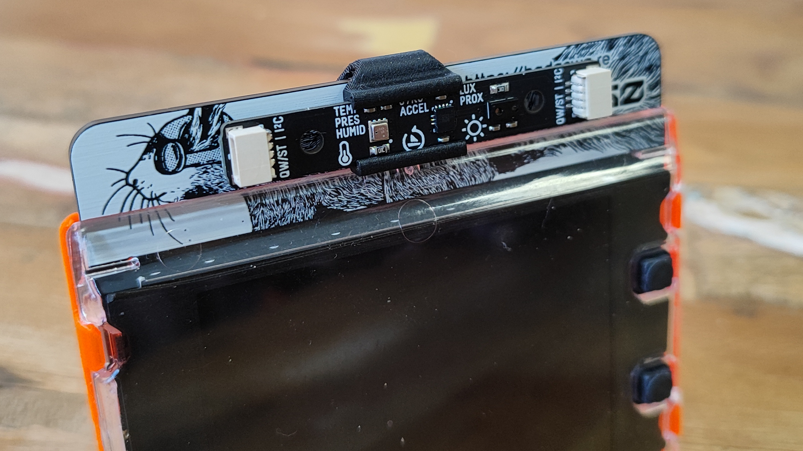
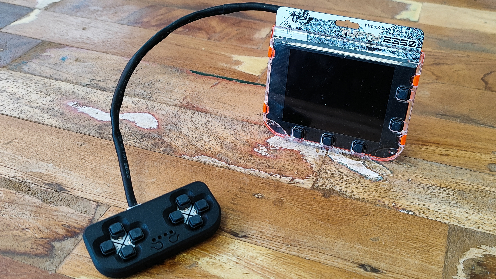
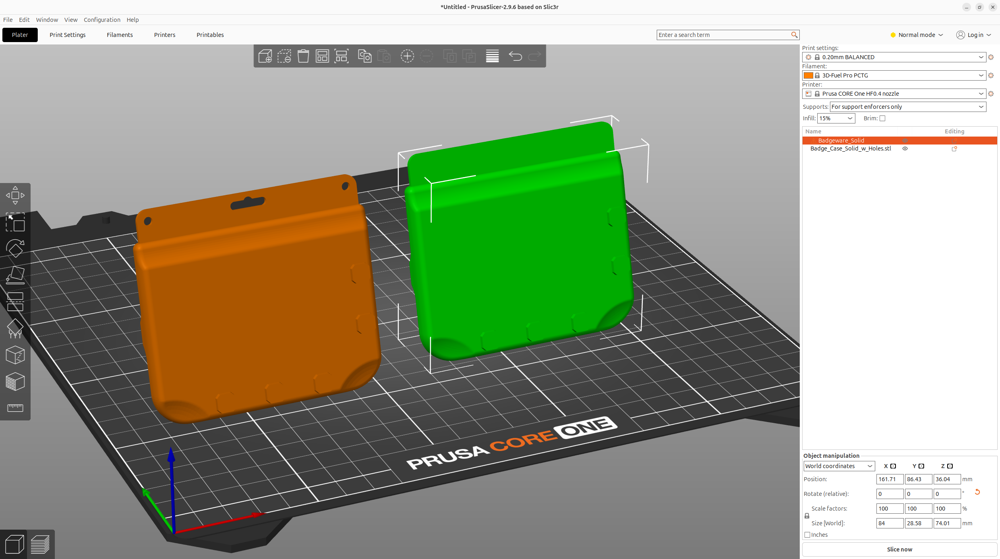

# Pimoroni Badgeware — Printables models (mirror)

Every model in Pimoroni's **Badgeware** collection on Printables, in **every format offered** — each model is included as both an **STL** (print-ready mesh) and a **STEP** (editable CAD solid), exactly as published by Pimoroni.

Source collection: https://www.printables.com/@pimoroni/collections/3460153
Author: [Pimoroni](https://www.printables.com/@pimoroni) · Retrieved 2026-10-31 · File sizes and SHA-256 hashes verified against Printables (see [`MANIFEST.md`](MANIFEST.md))

Badgeware is Pimoroni's RP2350-based badge platform — Badger 2350 (e-paper), Tufty 2350 (colour IPS) and Blinky 2350 (LED matrix): https://badgewa.re

## Models

| Model | Preview | Files | Licence |
| --- | --- | --- | --- |
| [**Badgeware Stand**](models/badgeware-stand/) — A neat stand to give your Badgeware some extra desktop stability. |  | BadgewareStand_Final.step (676.5 KiB), Badge Stand.stl (773.3 KiB) | BSD-2-Clause |
| [**Badgeware Multi-Sensor Stick Clip**](models/badgeware-multi-sensor-stick-clip/) — Designed for our range of Badgeware boards, this clip holds the multi-sensor stick firmly in place. |  | Multi Sensor Clip.step (82.2 KiB), Multi Sensor Fitting.stl (178.4 KiB) | BSD-2-Clause |
| [**Qw/ST Pad Game Controller Case**](models/qwst-pad-game-controller-case/) — Designed for our Qw/ST game controller, this case keeps your controller safe and sound while you get your game on! |  | QwST Pad Casing Front.step (319.9 KiB), QwST Pad Casing Front.stl (228.2 KiB), QwST Pad Casing Back.stl (79.4 KiB), QwST Pad Casing Back.step (71.9 KiB) | BSD-2-Clause |
| [**Pimoroni Badgeware Blank**](models/pimoroni-badgeware-blank/) — Add Badgeware to your next 3D project! |  | Badgeware_Solid.step (573.8 KiB), Badgeware_Solid.stl (2296.1 KiB), Badge_Case_Solid_w_Holes.step (591.8 KiB), Badge_Case_Solid_w_Holes.stl (1754.6 KiB) | OCL v1.1 + GAtt v1 |

No pre-sliced print files (G-code / SLA) are offered for any of these models on Printables — the Model files above are the complete set. Each model folder also contains the model's cover photo from Printables (`preview.jpg` / `preview.png`) for identification.

## Licences & attribution

All models are © Pimoroni and are mirrored here under their original licences, with attribution:

- **Badgeware Stand**, **Badgeware Multi-Sensor Stick Clip** and **Qw/ST Pad Game Controller Case** — BSD License (BSD-2-Clause): [`licenses/BSD-2-Clause.txt`](licenses/BSD-2-Clause.txt)
- **Pimoroni Badgeware Blank** — Open Community License v1.1 + General Attribution v1 (OCL v1.1 + GAtt v1): [`licenses/OCL-v1.1-plus-GAtt-v1.txt`](licenses/OCL-v1.1-plus-GAtt-v1.txt). Under OCL, derivatives must be shared under OCL and the GAtt plugin requires attribution to the creator (Pimoroni) when derivatives are distributed; commercial reselling is not permitted.

This is an unofficial mirror for convenience (e.g. offline / CAD work). It is not affiliated with or endorsed by Pimoroni. For the canonical, most up-to-date files, use the Printables pages linked from each model folder.
