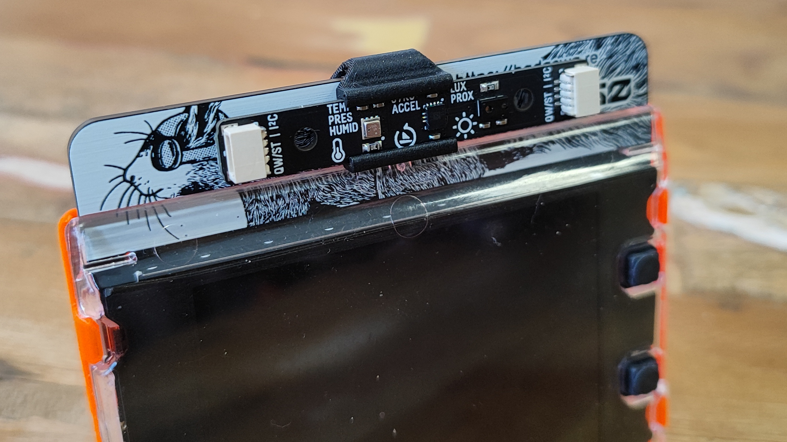

# Badgeware Multi-Sensor Stick Clip

**Designed for our range of Badgeware boards, this clip holds the multi-sensor stick firmly in place.**

Designed for our range of Badgeware devices, this clip will keep your multi-sensor stick safe and sound. Clipping into the lanyard cutout, the clip has a guide rail to slide your sensor stick into place. The friction fit will keep things safe, but you can easily remove it when it is not longer needed. The multi-sensor stick has three sensors. Bosch BME280 temperature, pressure, humidity sensor. Lite-On LTR-559ALS-01 digital light and proximity sensor. STMicroelectronics LSM6DS3TR-C accelerometer and gyroscope. Plug it in to your Badgeware board and you'll have live sensor data in the palm of your hand, on your desk, in your science experiment! For best results print this on its side with a 0.12 layer height.

## Files

| File | Format | Size | SHA-256 |
| --- | --- | ---: | --- |
| [Multi Sensor Clip.step](Multi%20Sensor%20Clip.step) | STEP | 82.2 KiB (84125 bytes) | `429609b99eaca34c…` |
| [Multi Sensor Fitting.stl](Multi%20Sensor%20Fitting.stl) | STL | 178.4 KiB (182684 bytes) | `86309d3b1957b1ea…` |

Full SHA-256 hashes for every file are in [`MANIFEST.md`](../../MANIFEST.md).

## Source & licence

- Author: [Pimoroni](https://www.printables.com/@pimoroni) on Printables
- Original model: https://www.printables.com/model/1726590-badgeware-multi-sensor-stick-clip
- Part of the [Badgeware collection](https://www.printables.com/@pimoroni/collections/3460153) on Printables
- Published on Printables: 2026-05-20
- Licence: **BSD License** — see [`licenses/BSD-2-Clause.txt`](../../licenses/BSD-2-Clause.txt)
- Category: Portable Devices · Tags: sensor, raspberry, pi, raspberrypi, pimoroni, bme280, pico, rp2350, badgeware
