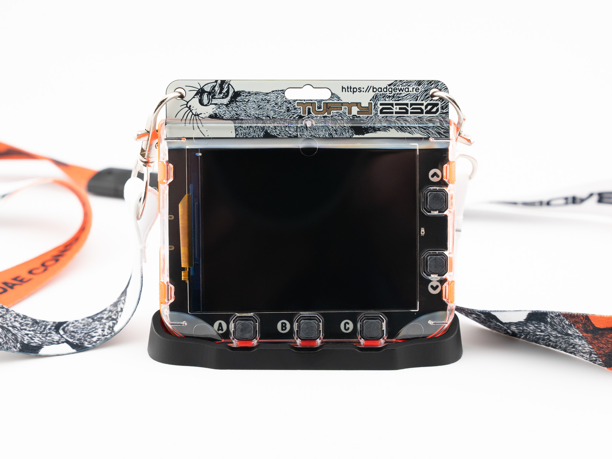

# Badgeware Stand

**A neat stand to give your Badgeware some extra desktop stability.**

With built-in WiFi and Bluetooth, Badgeware offers full connectivity right out of the box. Your apps can fetch live data from the internet, control remote systems, or even chat with other badges - perfect for creating fun, interactive experiences that go beyond a single device. We designed this simple stand to help stop our Badgeware devices skidding around on our desk and toppling over from over-enthusiastic button pushes.  Badgeware comes in three models Badger 2350 , a 2.7 inch 264 x 176 pixels greyscale e-paper display. Tufty 2350 , a 2.8 inch, 320 x 240 full-colour IPS display. Blinky 2350 , a 3.6 inch, 872 individually adjustable white LEDs matrix display. All models are powered by a Raspberry Pi RP2350A (Dual Arm Cortex M33 running at 250MHz with 520KB of SRAM). We've included 16MB of QSPI flash storage and 8MB of PSRAM. Onboard Wi-Fi and Bluetooth via a Raspberry Pi RM2 module, and a 1000mAh LiPo battery and charging circuit, all wrapped up in polycarbonate case.

## Files

| File | Format | Size | SHA-256 |
| --- | --- | ---: | --- |
| [BadgewareStand_Final.step](BadgewareStand_Final.step) | STEP | 676.5 KiB (692745 bytes) | `fe368fb18e172ebe…` |
| [Badge Stand.stl](Badge%20Stand.stl) | STL | 773.3 KiB (791884 bytes) | `3dbc384e52e25f33…` |

Full SHA-256 hashes for every file are in [`MANIFEST.md`](../../MANIFEST.md).

## Source & licence

- Author: [Pimoroni](https://www.printables.com/@pimoroni) on Printables
- Original model: https://www.printables.com/model/1726520-badgeware-stand
- Part of the [Badgeware collection](https://www.printables.com/@pimoroni/collections/3460153) on Printables
- Published on Printables: 2026-05-20
- Licence: **BSD License** — see [`licenses/BSD-2-Clause.txt`](../../licenses/BSD-2-Clause.txt)
- Category: Portable Devices · Tags: raspberrypi, pimoroni, pico, pico2, rp2350, badgeware
