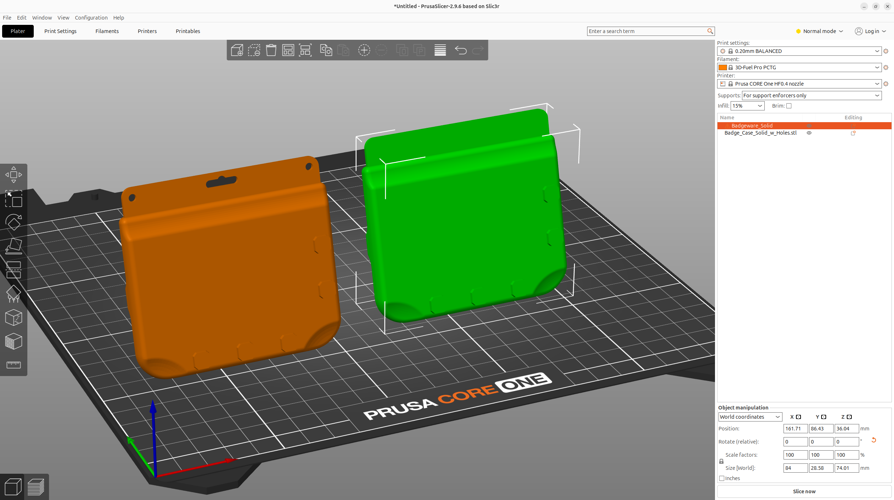

# Pimoroni Badgeware Blank

**Add Badgeware to your next 3D project!**

Our range of Badgeware boards already come with a great polycarbonate case, but what if you want to integrate Badgeware into your own 3D printed project? This 3D "buck" (a full-scale template which can be built around) has been designed to the exact dimensions of our Badgeware boards and their cases. Use this buck as the foundation for your next 3D printable, Badgeware project. Drop the file into your favourite CAD application and then build your project around it. We have two versions of the "buck". One with, and one without lanyard holes. Both are provided as STL and STEP files.

## Files

| File | Format | Size | SHA-256 |
| --- | --- | ---: | --- |
| [Badgeware_Solid.step](Badgeware_Solid.step) | STEP | 573.8 KiB (587580 bytes) | `2ef996ace600ae60…` |
| [Badgeware_Solid.stl](Badgeware_Solid.stl) | STL | 2296.1 KiB (2351184 bytes) | `a14c0eebeb90411a…` |
| [Badge_Case_Solid_w_Holes.step](Badge_Case_Solid_w_Holes.step) | STEP | 591.8 KiB (606013 bytes) | `6ecc8e358482b177…` |
| [Badge_Case_Solid_w_Holes.stl](Badge_Case_Solid_w_Holes.stl) | STL | 1754.6 KiB (1796684 bytes) | `b4bddff1c8f23b8d…` |

Full SHA-256 hashes for every file are in [`MANIFEST.md`](../../MANIFEST.md).

## Source & licence

- Author: [Pimoroni](https://www.printables.com/@pimoroni) on Printables
- Original model: https://www.printables.com/model/1779998-pimoroni-badgeware-blank
- Part of the [Badgeware collection](https://www.printables.com/@pimoroni/collections/3460153) on Printables
- Published on Printables: 2026-07-13
- Licence: **Open Community License v1.1 + General Attribution v1** — see [`licenses/OCL-v1.1-plus-GAtt-v1.txt`](../../licenses/OCL-v1.1-plus-GAtt-v1.txt)
- Category: Electronics · Tags: prop, badge, raspberrypi, pimoroni, raspberrypipico, rp2040
