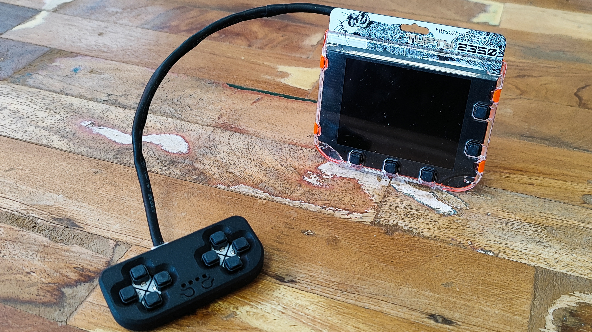

# Qw/ST Pad Game Controller Case

**Designed for our Qw/ST game controller, this case keeps your controller safe and sound while you get your game on!**

This is a case for our Qw/ST pad, an I2C game controller for Qw/ST, Stemma QT / Qwiic compatible devices such as our range of Badgeware boards. Printed in two parts, this case needs no supports and is best printed with a 0.12 layer height.

## Files

| File | Format | Size | SHA-256 |
| --- | --- | ---: | --- |
| [QwST Pad Casing Front.step](QwST%20Pad%20Casing%20Front.step) | STEP | 319.9 KiB (327533 bytes) | `782bf91e74f6a345…` |
| [QwST Pad Casing Front.stl](QwST%20Pad%20Casing%20Front.stl) | STL | 228.2 KiB (233684 bytes) | `0a349303ee1e6c46…` |
| [QwST Pad Casing Back.stl](QwST%20Pad%20Casing%20Back.stl) | STL | 79.4 KiB (81284 bytes) | `57e57b63923f3ede…` |
| [QwST Pad Casing Back.step](QwST%20Pad%20Casing%20Back.step) | STEP | 71.9 KiB (73622 bytes) | `dd069028f121551e…` |

Full SHA-256 hashes for every file are in [`MANIFEST.md`](../../MANIFEST.md).

## Source & licence

- Author: [Pimoroni](https://www.printables.com/@pimoroni) on Printables
- Original model: https://www.printables.com/model/1726599-qwst-pad-game-controller-case
- Part of the [Badgeware collection](https://www.printables.com/@pimoroni/collections/3460153) on Printables
- Published on Printables: 2026-05-20
- Licence: **BSD License** — see [`licenses/BSD-2-Clause.txt`](../../licenses/BSD-2-Clause.txt)
- Category: Portable Devices · Tags: game, controller, raspberrypi, pimoroni, i2c, qwiic, rp2040, stemmaqt, rp2350, badgeware, qwst
